# Component hierarchy (React version)

The planned component tree for the **whole** app. Only the shell (Exercise 3, Demo 9) and the Dashboard (Demo 10) are
built in this exercise; the other pages follow in Exercises 4 and 5.

Derived from the current vanilla views in `src/views/`: every block of markup that a view builds as an HTML string
became a candidate component.

## Diagram

Arrows mean "renders". Shared components (bottom row) are drawn once, so every arrow into them is a place where they are
reused.

```mermaid
flowchart TD
  App --> Header
  App --> NavBar
  App --> LoadingOverlay

  App --> DashboardPage
  App --> EvidencePage
  App --> PeoplePage
  App --> TimelinePage
  App --> WorkspacePage
  App --> NotFoundPage

  DashboardPage --> HowToCard
  DashboardPage --> CaseSummary
  DashboardPage --> StatCard
  DashboardPage --> ReviewProgress
  DashboardPage --> RecentEvidenceList
  DashboardPage --> RecentTimelineList

  EvidencePage --> EvidenceFilters
  EvidencePage --> EvidenceCard
  EvidencePage --> EvidenceDetail
  EvidenceCard --> BookmarkButton
  EvidenceDetail --> NoteEditor

  PeoplePage --> TabBar
  PeoplePage --> PersonCard
  PeoplePage --> LocationCard

  TimelinePage --> TimelineFilters
  TimelinePage --> TimelineEventCard
  TimelinePage --> EvidenceQuickView

  WorkspacePage --> BookmarkList
  WorkspacePage --> NotesList
  WorkspacePage --> HypothesisForm

  %% shared components
  CaseSummary --> Badge
  RecentEvidenceList --> Badge
  EvidenceCard --> Badge
  TimelineEventCard --> Badge

  EvidenceCard --> EvidenceMeta
  EvidenceDetail --> EvidenceMeta
  EvidenceQuickView --> EvidenceMeta

  EvidenceCard --> TagChip
  EvidenceDetail --> TagChip

  RecentEvidenceList --> MiniListItem
  RecentTimelineList --> MiniListItem
  BookmarkList --> MiniListItem
  NotesList --> MiniListItem

  EvidenceFilters --> FilterSelect
  TimelineFilters --> FilterSelect

  classDef now fill:#d4edda,stroke:#2e7d32,color:#000
  classDef shared fill:#fff3cd,stroke:#b8860b,color:#000
  class App,Header,NavBar,NotFoundPage,DashboardPage,HowToCard,CaseSummary,StatCard,ReviewProgress,RecentEvidenceList,RecentTimelineList now
  class Badge,EvidenceMeta,TagChip,MiniListItem,FilterSelect shared
```

Green: built in Exercise 3. Yellow: shared components (used in more than one place). White: later exercises.

## Where the data comes from

- **Case data** (`case.json`, `evidence.json`, `people.json`, `locations.json`, `timeline.json`): loaded **once** by
  `App` and kept in React state there. `App` passes what each page needs down as props.
- **Bookmarks and notes**: read from `localStorage` when the app starts (the existing `storage.ts`), kept in `App`'s
  state, so the Evidence and Workspace pages see the same values.
- **Derived values** (counts, review percentage, "5 most recent"): not stored, calculated by the page while rendering.

This is the simplest working setup ("pass props down"). If passing props through many levels becomes tedious, a later
exercise can replace it (e.g. with React Context).

## Props of selected components

| Component        | Props                                                                                               | Where the data comes from                                                                                          |
| ---------------- | --------------------------------------------------------------------------------------------------- | ------------------------------------------------------------------------------------------------------------------ |
| `NavBar`         | `currentRoute: string`, `onNavigate: (view: ViewName) => void`                                      | `App` (it holds the route from the URL hash in state, Demo 9); a string, because the hash can name an unknown view |
| `StatCard`       | `value: number`, `label: string`                                                                    | `DashboardPage` counts the loaded arrays, e.g. `evidence.length`, `bookmarks.length`                               |
| `CaseSummary`    | `caseFile: CaseFile`                                                                                | `case.json`, loaded by `App`, passed through `DashboardPage`                                                       |
| `ReviewProgress` | `percent: number`                                                                                   | `DashboardPage` calculates it from `evidence.json` (reviewed / total)                                              |
| `Badge`          | `text: string`, `variant: string`                                                                   | the parent: e.g. `evidence.status` + `getStatusBadgeClass()` from `utils/format.ts`                                |
| `MiniListItem`   | `title: string`, `children: ReactNode`                                                              | the parent list: an evidence id, a formatted date, a note text, ...                                                |
| `EvidenceCard`   | `evidence: Evidence`, `isBookmarked: boolean`, `onToggleBookmark: () => void`, `onOpen: () => void` | `evidence.json` + bookmarks from `localStorage`, both held in `App`, passed through `EvidencePage`                 |
| `PersonCard`     | `person: Person`, `evidenceCount: number`                                                           | `people.json`; `PeoplePage` counts the person's evidence items                                                     |
