# Component hierarchy (React version)

The planned component tree for the **whole** app. Only the shell (Exercise 3, Demo 9) and the Dashboard (Demo 10) are
built in this exercise; the other pages follow in Exercises 4 and 5.

Derived from the current vanilla views in `src/views/`: every block of markup that a view builds as an HTML string
became a candidate component.

## Diagram

Arrows mean "renders". Shared components (bottom row) are drawn once, so every arrow into them is a place where they are
reused.

```mermaid
flowchart TD
  App --> AppLayout
  AppLayout --> NavBar
  App --> LoadingOverlay

  App --> DashboardPage
  App --> EvidencePage
  App --> PeoplePage
  App --> TimelinePage
  App --> WorkspacePage
  App --> NotFoundPage

  DashboardPage --> HowToCard
  DashboardPage --> CaseSummary
  DashboardPage --> StatCard
  DashboardPage --> ReviewProgress
  DashboardPage --> RecentEvidenceList
  DashboardPage --> RecentTimelineList

  EvidencePage --> EvidenceFilters
  EvidencePage --> EvidenceCard
  EvidencePage --> EvidenceDetail
  EvidenceCard --> BookmarkButton
  EvidenceDetail --> NoteEditor

  PeoplePage --> TabBar
  PeoplePage --> PersonCard
  PeoplePage --> LocationCard

  TimelinePage --> TimelineFilters
  TimelinePage --> TimelineEventCard
  TimelinePage --> EvidenceQuickView

  WorkspacePage --> BookmarkList
  WorkspacePage --> NotesList
  WorkspacePage --> HypothesisForm

  %% shared components
  CaseSummary --> Badge
  RecentEvidenceList --> Badge
  EvidenceCard --> Badge
  TimelineEventCard --> Badge

  EvidenceCard --> EvidenceMeta
  EvidenceDetail --> EvidenceMeta
  EvidenceQuickView --> EvidenceMeta

  EvidenceCard --> TagChip
  EvidenceDetail --> TagChip


  EvidenceFilters --> FilterSelect
  TimelineFilters --> FilterSelect

  classDef now fill:#d4edda,stroke:#2e7d32,color:#000
  classDef shared fill:#fff3cd,stroke:#b8860b,color:#000
  class App,AppLayout,NavBar,NotFoundPage,DashboardPage,HowToCard,CaseSummary,StatCard,ReviewProgress,RecentEvidenceList,RecentTimelineList now
  class Badge,EvidenceMeta,TagChip,FilterSelect shared
```

Green: built in Exercise 3. Yellow: shared components (used in more than one place). White: later exercises.

## Where the data comes from

- **Case data** (`case.json`, `evidence.json`, `people.json`, `locations.json`, `timeline.json`): loaded **once** by
  `App` and kept in React state there. `App` passes what each page needs down as props.
- **Bookmarks and notes**: read from `localStorage` when the app starts (the existing `storage.ts`), kept in `App`'s
  state, so the Evidence and Workspace pages see the same values.
- **Derived values** (counts, review percentage, "5 most recent"): not stored, calculated by the page while rendering.

This is the simplest working setup ("pass props down"). If passing props through many levels becomes tedious, a later
exercise can replace it (e.g. with React Context).

## Props of selected components

| Component        | Props                                                                                               | Where the data comes from                                                                          |
| ---------------- | --------------------------------------------------------------------------------------------------- | -------------------------------------------------------------------------------------------------- |
| `NavBar`         | none                                                                                                | the current URL, read by React Router's `NavLink` (marks the matching link as active)              |
| `StatCard`       | `value: number`, `label: string`                                                                    | `DashboardPage` counts the loaded arrays, e.g. `evidence.length`, `bookmarks.length`               |
| `CaseSummary`    | `caseFile: CaseFile`                                                                                | `case.json`, loaded by `App`, passed through `DashboardPage`                                       |
| `ReviewProgress` | `percent: number`                                                                                   | `DashboardPage` calculates it from `evidence.json` (reviewed / total)                              |
| `Badge`          | `text: string`, `variant: string`                                                                   | the parent: e.g. `evidence.status` + `getStatusBadgeClass()` from `utils/format.ts`                |
| `EvidenceCard`   | `evidence: Evidence`, `isBookmarked: boolean`, `onToggleBookmark: () => void`, `onOpen: () => void` | `evidence.json` + bookmarks from `localStorage`, both held in `App`, passed through `EvidencePage` |
| `PersonCard`     | `person: Person`, `evidenceCount: number`                                                           | `people.json`; `PeoplePage` counts the person's evidence items                                     |

## Presentational vs. feature components

**Rule used:** a component is a **feature** component if it knows _where data comes from or what it means for the app_:
it holds state or effects, receives the whole `CaseData`, sorts / filters / counts / combines data, or triggers app
navigation itself. A component is **presentational** if it receives exactly what it shows as props and only turns that
into markup. Formatting a value for display (`formatDate`) or picking a CSS class for a value still counts as
presentational.

| Component                                   | Kind                    | Why                                                                                                                              |
| ------------------------------------------- | ----------------------- | -------------------------------------------------------------------------------------------------------------------------------- |
| `App`                                       | feature                 | holds the route, the case data and the bookmarks in state; loads data in an effect; decides what to render                       |
| `DashboardPage`                             | feature                 | gets `CaseData`, calculates counts, review percentage and the "recent" lists                                                     |
| `PeoplePage`                                | feature                 | gets `CaseData`, counts the evidence per person                                                                                  |
| `TimelinePage`                              | feature                 | gets `CaseData`, sorts the events, resolves location ids to names                                                                |
| `TimelineFilters`                           | feature (borderline)    | turns people, locations and events into option lists (incl. the set of event types); the dropdowns themselves are `FilterSelect` |
| `AppLayout`, `NavBar`, `HowToCard`          | presentational          | the frame, the nav and the intro card; navigation is plain links (`NavLink`/`Link`) to fixed paths                               |
| `Badge`                                     | presentational (shared) | generic, knows nothing about the case; used by two features                                                                      |
| `Panel`, `BulletList`, `FilterSelect`       | presentational          | generic building blocks, so far used inside one feature each                                                                     |
| `CaseSummary`, `StatCard`, `ReviewProgress` | presentational          | show the values they get (`CaseSummary` only formats the facts line)                                                             |
| `RecentEvidenceList`, `RecentTimelineList`  | presentational          | render the already selected items                                                                                                |
| `PersonCard`, `LocationCard`                | presentational          | one record each; the evidence count comes in as a number                                                                         |
| `TimelineEventCard` (with `LocationLine`)   | presentational          | one event; location names come in resolved; certainty → badge color is a display decision                                        |
| `PlaceholderPage`, `NotFoundPage`           | presentational          | static text; `NotFoundPage` shows the unmatched path from `useLocation()`                                                        |
